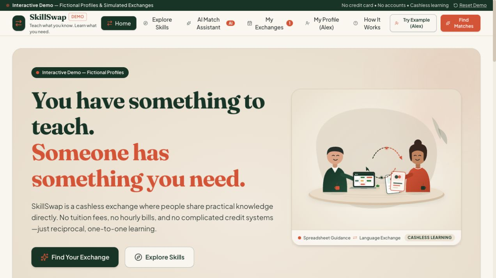
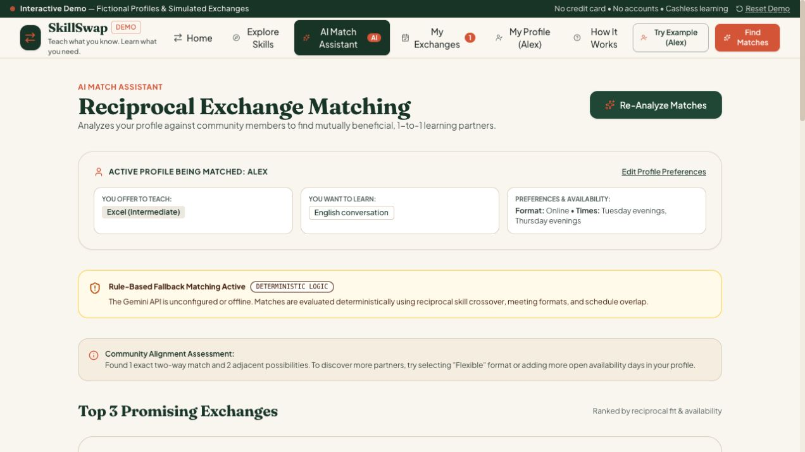

# SkillSwap

An educational demo for exchanging practical skills without money. Created by Kaio Gervason de Oliveira with AI assistance in Google AI Studio.

[Live demo](https://skillswap-direct-skill-exchange-without-money.ai.studio/)

## Features

- Editable demo profiles and a directory of eight fictional community members.
- Skill search and filters, reciprocal matching, and a clearly labeled rule-based fallback.
- Simulated exchange proposals, acceptance, completion, and private reflections.
- Responsive React interface and original SVG illustrations.

This is a learning project: profiles are fictional, exchanges are simulated, and data is stored in the browser. It does not send real messages or provide verified user accounts.

## Run locally

Use Node.js 22 or newer. The checked-in package-lock.json records the dependency versions used for validation.

```sh
npm ci
cp .env.example .env
npm run dev
```

Open http://localhost:3000. The rule-based demo works without a Gemini key. To enable AI matching, configure your own GEMINI_API_KEY in .env. Never commit that file. API usage may incur charges.

```sh
npm run lint
npm run build
NODE_ENV=production npm start
```

## Technology

React, TypeScript, Vite, Tailwind CSS, Express, Google Gen AI SDK, and local storage.

## Validation

Validated locally on October 21, 2026:

- npm installation completed after removing an unnecessary direct esbuild pin that conflicted with Vite.
- TypeScript check (`npm run lint`) passed.
- Production build (`npm run build`) passed.
- Health endpoint and the no-key fallback endpoint responded successfully.
- Browser smoke test matched the fictional Alex profile with Elena and displayed the labeled fallback results.

Gemini matching was validated locally on October 21, 2026 with `gemini-3.1-flash-lite`: tests with three candidates and the full eight-profile demo dataset returned Elena as a reciprocal Excel / English conversation match and a 60-minute session plan. The full-dataset request completed in about 5.1 seconds with `source: gemini`. The model can be changed with `GEMINI_MODEL` in `.env`. Requests have a 25-second timeout and no automatic retries; unavailable requests use the rule-based fallback. Provider availability remains variable (503 errors were also observed). This is a demo, not a production service.

## Screenshots





## My contribution and AI assistance

I defined the cashless skill-exchange concept, selected the visual direction, guided AI-assisted implementation in Google AI Studio, and tested demo workflows. The project explores reciprocal matching and clear labeling of fictional profiles and simulated exchanges. Subsequent AI-assisted repository preparation recovered the source, documented setup, and verified installation, type checking, build, and fallback matching.

## Source history

The source was recovered directly from the Google AI Studio editor on October 21, 2026. `SkillSwap-source.zip` is the original recovery backup; the browsable files include the dependency compatibility correction and lockfile. No real API keys, node_modules, or generated builds are intended for this repository.

## Author

Kaio Gervason de Oliveira · [LinkedIn](https://www.linkedin.com/in/kaio-gervason-9b3217228/)
